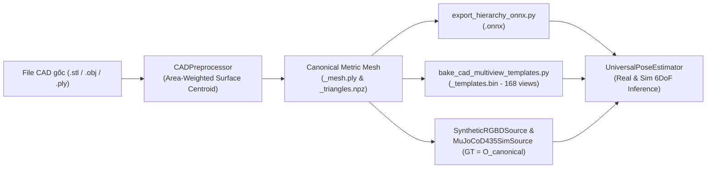

# Kế hoạch Chuẩn hóa Đồng bộ Sim-to-Real & Bộ giải 6DoF Pose Tổng quát (100% Universal)

> [!IMPORTANT]
> **Nguyên tắc thiết kế cốt lõi (Zero Object-Specific Heuristics):**
> Toàn bộ kế hoạch dưới đây chỉ sử dụng các bất biến hình học 3D–2D tổng quát (Trọng tâm diện tích bề mặt, Đồng nhất hệ quy chiếu Canonical `_mesh.ply`, Trọng tâm các mặt nhìn thấy theo hướng tia nhìn, và Độ phủ hình chiếu Silhouette 2D). **Tuyệt đối không dùng** bất kỳ giả định riêng nào về hình dáng vật thể (không giả định vật thể đặt đứng theo `up_cam`, không tách riêng thân trụ/quai cốc, không hardcode tên hay kích thước CAD).

---

## Kiến trúc Đồng bộ Hệ quy chiếu Sim–Real (Single Canonical Frame)

---

## Giai đoạn 1: Đồng bộ hóa Hệ tọa độ Canonical giữa CAD, ONNX, Templates và Simulation

### Bước 1.1: Chuẩn hóa Gốc tọa độ theo Trọng tâm Diện tích Bề mặt (Area-Weighted Surface Centroid) & Sửa lỗi cắt tên file
* **File tác động:**
  * [CADPreprocessor.cpp](file:///home/huyen1905/TMCAD/src/CADPreprocessor.cpp#L124-L168)
  * [CADHierarchy.cpp](file:///home/huyen1905/TMCAD/src/CADHierarchy.cpp#L83-L90)
* **Vấn đề hiện tại:**
  1. `mesh->GetCenter()` tính trung bình cộng các đỉnh thô không trọng số. Khi file CAD có mật độ chia lưới (tessellation) không đều (mặt cong/lỗ/tay cầm có hàng nghìn đỉnh nhỏ, mặt phẳng có ít đỉnh), gốc tọa độ `(0,0,0)` bị kéo lệch mạnh về phía có lưới dày (ví dụ lệch `+34.96 mm` trên `Hokori_330ml_Mug`).
  2. `cadFi.baseName()` cắt tên file tại dấu chấm đầu tiên (`.5cm`), làm sinh sai tên file `_mesh.ply` và `_triangles.npz`.
* **Giải pháp 100% Universal:**
  1. Tính trọng tâm diện tích bề mặt (Area-Weighted Surface Centroid) trên toàn bộ lưới tam giác:
     $$\mathbf{c}_{\text{surf}} = \frac{\sum_{i=1}^{M} A_i \cdot \frac{\mathbf{v}_{i,0} + \mathbf{v}_{i,1} + \mathbf{v}_{i,2}}{3}}{\sum_{i=1}^{M} A_i}, \quad A_i = \frac{1}{2} \|(\mathbf{v}_{i,1} - \mathbf{v}_{i,0}) \times (\mathbf{v}_{i,2} - \mathbf{v}_{i,0})\|$$
     Dịch chuyển `mesh->Translate(-c_surf)` để gốc `(0,0,0)` luôn bất biến với mật độ chia lưới tam giác của phần mềm CAD.
  2. Đổi `cadFi.baseName()` thành `cadFi.completeBaseName()` trong `CADPreprocessor.cpp` và `CADHierarchy.cpp`.

### Bước 1.2: Đồng bộ `bake_cad_multiview_templates.py` dùng đúng hệ tọa độ Canonical của `_mesh.ply`
* **File tác động:** [bake_cad_multiview_templates.py](file:///home/huyen1905/TMCAD/scripts/bake_cad_multiview_templates.py#L46-L135)
* **Vấn đề hiện tại:** `find_cad_mesh()` nạp file `.stl` thô trước `_mesh.ply` và tự dịch tâm theo `0.5 * (bounds[0] + bounds[1])`, dẫn tới ma trận xoay `R_cw` trong `<CAD>_templates.bin` lệch gốc tọa độ với `<CAD>.onnx` (được đóng gói từ `_triangles.npz` / `_mesh.ply`).
* **Giải pháp 100% Universal:**
  1. Trong `find_cad_mesh()`, ưu tiên tuyệt đối `<cad_name>_mesh.ply` (hoặc khôi phục trực tiếp từ `<cad_name>_triangles.npz`).
  2. Khi nạp từ `_mesh.ply` / `_triangles.npz`, **giữ nguyên gốc tọa độ `(0,0,0)` canonical** (không dịch chuyển lại theo `bounds`) khi chiếu 168 hướng nhìn để ma trận `R_cw` và hình chiếu `64x64` khớp 1:1 với `_mesh_pts` trong ONNX.

### Bước 1.3: Đồng bộ Gốc tọa độ Ground-Truth và Nạp Mesh trong `MuJoCoD435SimSource` & `MainWindow`
* **File tác động:**
  * [MuJoCoD435SimSource.cpp](file:///home/huyen1905/TMCAD/src/MuJoCoD435SimSource.cpp#L905-L920)
  * [MuJoCoD435SimSource.cpp](file:///home/huyen1905/TMCAD/src/MuJoCoD435SimSource.cpp#L1015-L1040)
  * [MainWindow.cpp](file:///home/huyen1905/TMCAD/src/MainWindow.cpp#L1804-L1850)
* **Vấn đề hiện tại:**
  1. Khi nạp `.ply`, `MuJoCoD435SimSource` gọi `mesh->Translate(-centerXY)` làm lệch gốc `(0,0,0)` của `_mesh.ply`, đồng thời `getGroundTruthPose()` cộng thêm `cadCentroidOffset = 0.5 * (minBound + maxBound)` khiến `t_gt` lệch với gốc `(0,0,0)` mà `UniversalPoseEstimator` dự đoán.
  2. `MainWindow.cpp` dòng `1804` kiểm tra `isInteractiveWindowOpen()` thay vì `isOpen()`, làm MuJoCo ở chế độ offscreen không đổi vật thể khi người dùng chọn model `.onnx` khác.
* **Giải pháp 100% Universal:**
  1. Trong `MuJoCoD435SimSource::loadTargetMesh`, nếu nạp file `*_mesh.ply` (hệ tọa độ canonical), giữ nguyên toàn bộ tọa độ đỉnh 3D `(x, y, z)` và trả về `getGroundTruthPose()` đúng tại gốc `(0,0,0)` của body trong MuJoCo (`cadCentroidOffset = (0, 0, 0)`).
  2. Trong `MainWindow.cpp`, sửa điều kiện thành `activeMuJoCoSim_->isOpen()` và thống nhất ưu tiên nạp `<stem>_mesh.ply` ở cả lúc khởi tạo lẫn lúc chuyển model `.onnx`.

---

## Giai đoạn 2: Nâng cấp Toán học Tổng quát cho Bộ giải 6DoF Pose (Real & Sim)

### Bước 2.1: Khởi tạo Vị trí 3D theo Trọng tâm Bề mặt Nhìn thấy (Visible-Surface Centroid Alignment)
* **File tác động:** [UniversalPoseEstimator.cpp](file:///home/huyen1905/TMCAD/src/UniversalPoseEstimator.cpp#L3515-L3550)
* **Vấn đề hiện tại:** Khi khởi tạo vector tịnh tiến $\mathbf{t}_0$ cho mỗi ứng viên góc xoay $\mathbf{R}_0$, thuật toán đang lấy tâm đám mây điểm Depth tiền cảnh trừ đi tâm hộp bao cố định $\mathbf{R}_0 \cdot \text{cad\_mid}$. Với bất kỳ vật thể nào có hình học không đối xứng tâm hoặc khi chỉ nhìn thấy một phía bề mặt từ camera, tâm các điểm Depth đo được chính là **trọng tâm phần bề mặt nhìn thấy từ hướng camera**, không phải tâm hộp bao `cad_mid`.
* **Giải pháp 100% Universal:**
  * Với mỗi ứng viên góc xoay $\mathbf{R}_0$ và hướng tia nhìn $\mathbf{v}_{\text{ray}}$, tính trọng tâm bề mặt nhìn thấy $\mathbf{c}_{\text{vis}}(\mathbf{R}_0)$ từ tập điểm mẫu `_mesh_pts` / `_mesh_normals` có pháp tuyến hướng về camera ($(\mathbf{R}_0 \mathbf{n}_i) \cdot \mathbf{v}_{\text{ray}} < 0.15$):
    $$\mathbf{t}_0 = \mathbf{c}_{\text{depth\_front}} - \mathbf{R}_0 \, \mathbf{c}_{\text{vis}}(\mathbf{R}_0)$$
  * Công thức này đúng về mặt hình học chiếu cho mọi vật thể 3D ở mọi góc nghiêng 6DoF mà không cần giả định hình dạng.

### Bước 2.2: Bổ sung Silhouette Outside-Mask Penalty vào Hàm mục tiêu 2D–3D
* **File tác động:** [UniversalPoseEstimator.cpp](file:///home/huyen1905/TMCAD/src/UniversalPoseEstimator.cpp#L3680-L3790)
* **Vấn đề hiện tại:** Hàm `computeRgbSilhouetteChamferCost()` chỉ đo khoảng cách từ điểm biên chiếu 2D tới cạnh Canny gần nhất (`dt_canny`). Khi một phần cấu trúc bất đối xứng của CAD (như nhánh chữ L, vòi, quai, gờ lồi) xoay sai hướng ra vùng nền có cạnh nhiễu hoặc lơ lửng ngoài mask, `dt_canny` vẫn có thể thấp.
* **Giải pháp 100% Universal:**
  1. Truyền `fg_mask_2d` (từ `CADMaskMatcher` hoặc mask tiền cảnh Depth) vào `computeRgbSilhouetteChamferCost()` và `refinePoseByRgbSilhouette()`.
  2. Tính tỷ lệ điểm bề mặt CAD (`_mesh_pts` lấy mẫu thưa) khi chiếu lên ảnh 2D rơi **ra ngoài** `fg_mask_2d` (hoặc dùng bản đồ khoảng cách ngoài mask `dt_outside_mask`):
     $$E_{\text{total}}(\mathbf{R}, \mathbf{t}) = E_{\text{edge\_chamfer}}(\mathbf{R}, \mathbf{t}) + \lambda_{\text{sil}} \cdot E_{\text{outside\_mask}}(\mathbf{R}, \mathbf{t})$$
  3. Trong bước chọn ứng viên góc xoay đa hướng (Multi-Hypothesis Rotation Scoring) và tinh chỉnh 3 trục quán tính của vật thể, hàm $E_{\text{total}}$ sẽ tự động loại bỏ các tư thế có phần hình chiếu 3D thò ra ngoài vùng mask thực tế của vật thể trên ảnh 2D.

### Bước 2.3: Bảo toàn Điểm Depth trên Chi tiết Mảnh (2/4 Neighbor Continuity)
* **File tác động:** [CADSceneSegmenter.cpp](file:///home/huyen1905/TMCAD/src/CADSceneSegmenter.cpp#L484-L497)
* **Vấn đề hiện tại:** Bộ lọc flying-pixel trong `extractDepthPoints()` yêu cầu điểm Depth phải có đủ cả `4/4` điểm lân cận (`trái, phải, trên, dưới` cách `2 px`) có độ sâu chênh lệch `< 15 mm`. Các cấu trúc mảnh của bất kỳ vật thể nào (thanh mỏng, gân, quai, cạnh mảnh) chỉ rộng vài pixel sẽ bị xóa sạch khỏi đám mây điểm 3D.
* **Giải pháp 100% Universal:** Giữ lại điểm Depth nếu có **ít nhất 2/4 lân cận liên thông** (`valid_nbrs >= 2`) thỏa mãn ngưỡng liên tục độ sâu, giúp giữ được các dải cấu trúc mảnh 1D trong khi vẫn loại bỏ được các điểm nhiễu cô lập (isolated flying pixels).

---

## Giai đoạn 3: Kiểm chứng Đồng bộ Sim & Real (Verification Matrix)

Sau khi triển khai Giai đoạn 1 và 2, tiến hành build lại dữ liệu Canonical và kiểm chứng tự động trên 5 bài test chuẩn:

1. **Tạo lại dữ liệu Canonical đồng bộ cho `Hokori_330ml_Mug_M8xD8xC9.5cm_mm-v3`:**
   * Chạy `CADPreprocessor` để xuất lại `_mesh.ply` và `_triangles.npz` với Area-Weighted Centroid.
   * Cập nhật tensor mesh trong `.onnx` và chạy lại `bake_cad_multiview_templates.py` từ chính `_mesh.ply`.
2. **Kiểm chứng Simulation (`SyntheticRGBDSource` & `MuJoCoD435SimSource`):**
   * Đo sai số tuyệt đối giữa Pose dự đoán từ `UniversalPoseEstimator` và Ground-Truth của Sim: mục tiêu `|t_pred - t_gt| < 10 mm`, `rot_err < 10°`, hình chiếu OBB và hướng các chi tiết bất đối xứng khớp 1:1 với ảnh render.
3. **Kiểm chứng trên 4 bộ dữ liệu Thực tế (Regression & Accuracy Benchmark):**
   * **Hokori Mug `.bag`** (`d435if_record_20261118_104237.bag`, 429 frames): `Accepted >= 99%`, `Med RMSE <= 6.5 mm`, hộp bao 3D và trục hướng đúng về phía quai cốc trên ảnh overlay.
   * **Chin-su `.bag`** (`d435if_record_20261113_140907.bag`, 172 frames): Giữ vững `Accepted = 100%`, `Med RMSE <= 8.5 mm`.
   * **HOPE `obj_000002`** & **`TABLE-DEMO`**: Giữ vững `valid = 1`, `conf >= 0.78`.
